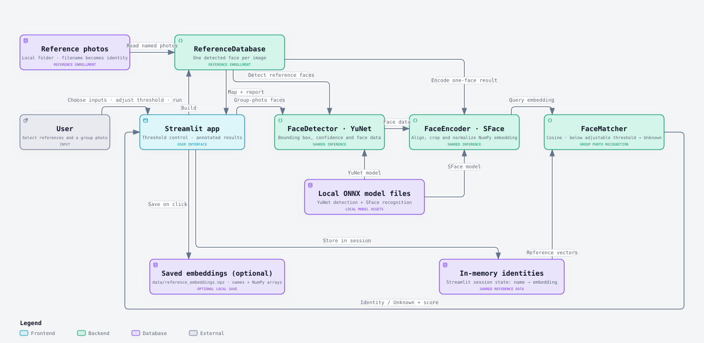

# Who Is in the Photo? — Architecture

This document describes the implemented architecture in `app.py` and the face processing modules under `src/`.

The upper row shows reference enrollment; the center row shows group-photo recognition. YuNet and SFace are shared between both paths. Local model assets, in-memory reference data, and the optional saved embedding file are separated below.

## Implemented workflows

### Reference enrollment

The Streamlit interface asks for a local folder of individually named reference photographs. `ReferenceDatabase.build()` reads JPG/JPEG/PNG files, uses each filename stem as the identity, and accepts an image only when it contains exactly one detected face. YuNet supplies the detection data to SFace, which aligns and crops the face and returns a normalized NumPy embedding. The resulting name-to-embedding map is kept in Streamlit session state. The user can optionally save that map as `data/reference_embeddings.npz`.

### Group-photo recognition

The user uploads a JPG/JPEG/PNG group photograph. The app converts it to BGR, runs YuNet detection, and for each detected face uses SFace to create an embedding. `FaceMatcher` compares the query embedding with each in-memory reference embedding using a dot product of normalized vectors (cosine similarity). The highest scoring identity is returned when its score is at least the UI threshold; otherwise the result is `Unknown`. The initial threshold is `0.363`, and the UI lets the user adjust it. The app shows the annotated photo and per-face results.

## Local processing and storage

The app describes photographs and embeddings as locally processed and says no online recognition APIs are used. The YuNet and SFace ONNX models are loaded from local `models/` paths. Reference photos are read from a local folder. Embeddings live in Streamlit session state during the app workflow and can optionally be written to a compressed NumPy `.npz` file.

`ReferenceDatabase.load()` can read an existing `.npz` file, but `app.py` does not call it. The current UI therefore builds the in-memory reference set from the selected photos for its recognition flow; the diagram does not imply that the saved file is loaded automatically.

## Source map

- [Streamlit UI, model setup, enrollment, upload, and results](app.py)
- [YuNet face detection](src/face_detector.py)
- [SFace embedding generation](src/face_encoder.py)
- [Cosine similarity and Unknown threshold](src/face_matcher.py)
- [Reference enrollment and NumPy `.npz` persistence](src/database.py)
- [Standalone interactive Archify diagram](.archify/architecture-who-is-in-the-photo-20261123-1743/who-is-in-the-photo.html)
- [Editable Archify candidate](.archify/architecture-who-is-in-the-photo-20261123-1743/candidate.json)
